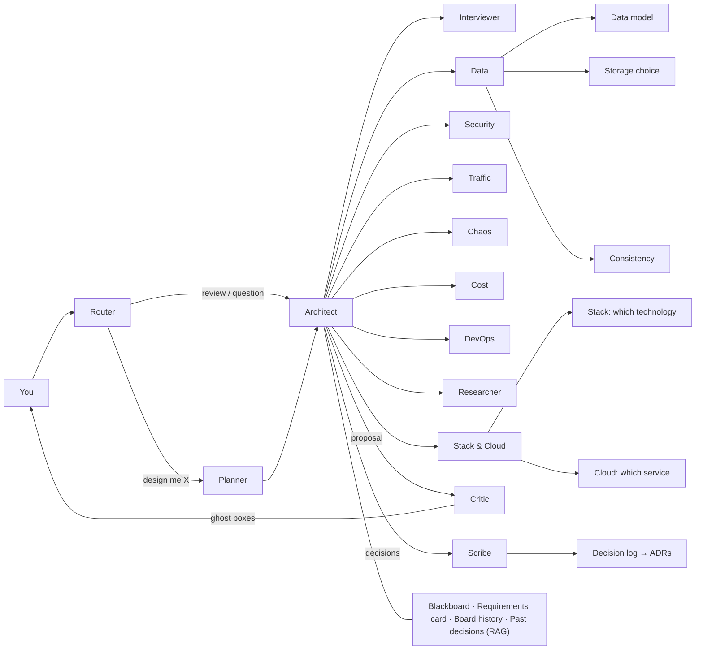

# Agent architecture — V1 (2026-10-21)

The first multi-agent design, brainstormed with the owner on DesignRoom boards on 2026-10-21. **Not built yet**: the running agent is still today's single loop. Kept as V1 so V2 can be compared with it. Tickets: M1-32 and the "Specialist lenses" epic in [M1-solo-board.md](../../tickets/M1-solo-board.md).

## The boards (snapshots)

Rooms live in the server's memory until M3, so the boards are saved here as JSON (the domain's shape, ids kept):

| Snapshot | What |
|---|---|
| [today-agent.json](v1/today-agent.json) | The agent as it runs today (after #72): browser → server → scope guard → loop → tools → output guards |
| [multi-agent-full.json](v1/multi-agent-full.json) | The whole V1 design on one board |
| [orchestration.json](v1/orchestration.json) | Who talks to whom: router, Architect, Planner, Critic, Scribe, the 9 specialists, memory, model |
| [lenses.json](v1/lenses.json) | What each specialist uses: tools, sub-agents (Stack & Cloud, Data), data in code |
| [cloud-catalogue.json](v1/cloud-catalogue.json) | Azure, AWS and GCP services per kind of box |

Draw one back into a room: `node scripts/board-snapshot.mjs load docs/agents/v1/orchestration.json` (the server must be running).

## V1 in one picture

- **Architect (lead):** owns the design, calls the specialists a question needs, arbitrates their conflicts, merges one proposal.
- **Specialists ("lenses"):** one focused prompt + its own tools each; rules and numbers come from code.
- **Sub-agents** only for judgment (Stack vs Cloud, Data model / storage / consistency); lookups stay tools.
- **Memory** lives in the room's Yjs document: shared by people and agents.

## What V1 gets wrong (why V2)

Found by the owner on 2026-10-21:

1. **Nobody owns the conversation.** The router classifies and the Architect designs, but no agent is responsible for _talking with the user_: understanding what they want, asking back, explaining results in their words, keeping the thread across turns.
2. **The flows are implicit.** "Review", "design me X", "is it secure?", "add a cache", "no, keep RabbitMQ", Accept/Reject — all go through the same arrows; nothing says what happens, in what order, for each.
