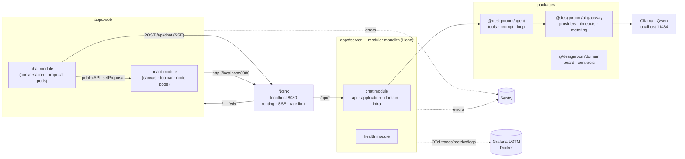
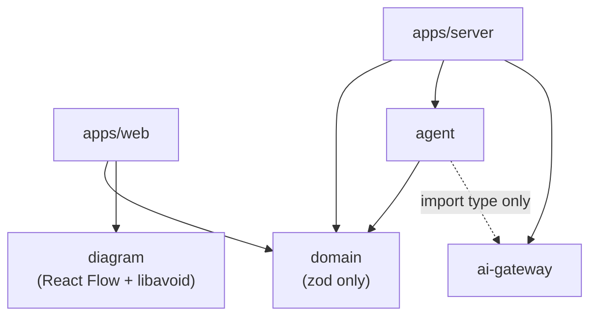
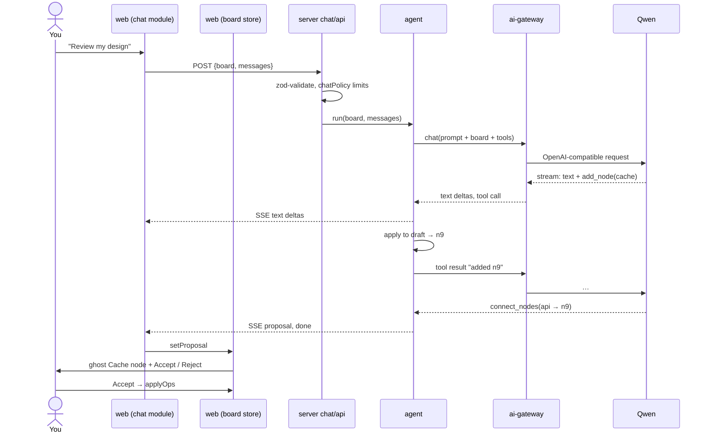
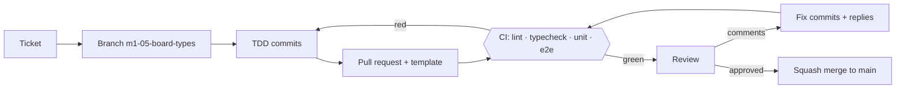

# DesignRoom — Architecture (M1)

> Status: **draft for review**. Covers M1 (solo board + AI that reviews the board and proposes changes). Later milestones extend it, see §11.
> Brainstorm history and parked topics: [architecture-notes.md](architecture-notes.md).

## 1. Decisions

| Area | Choice | Why |
|---|---|---|
| Approach | One problem at a time; **TDD** | Learn each layer properly; tests first keep the design honest |
| Language | TypeScript everywhere | Front end, back end and packages share types |
| Repo | **pnpm workspaces** | One install; internal packages via `workspace:*` |
| Packages | `domain`, `agent`, `ai-gateway` | Business rules, agent logic and LLM access are reusable and independently testable |
| Front end | React + Vite + **Tailwind** | Single-page app |
| FE structure | **Modules → pods**, atomic design, promotion on 2nd use, no `shared/` folders | Islands of business code that can grow without tangling |
| Client state | **Zustand** (one store per module) | Selectors, works outside React, easy to swap to Yjs in M2 |
| Server state | **TanStack Query (React Query)** | Caching/refetching of server data; no Redux |
| Diagram | React Flow (`@xyflow/react`) | Understands nodes + edges as a graph |
| Back end | **Hono** on Node, **modular monolith** | One deployable now, modules extractable to services later |
| BE module structure | **Four layers** (`api / application / domain / infra`) for modules with logic | Rules isolated from HTTP and I/O |
| AI model | **Qwen, local** via Ollama on an RTX 5060 Ti 16 GB — default `qwen3.5:9b` (stronger published agent/tool-calling scores, smaller, more context headroom, vision for A3), fallback `qwen3:14b` (Q4_K_M, 9.3 GB). **Confirmed by the M1-15 spike** ([results](spikes/M1-15-qwen.md)): 3/3 tool calls, ≈ 64 tok/s, answer in < 1 s, 6.1 GB at 16k context, thinking off. OpenAI-compatible API with `reasoning_effort: "none"` | Free, private; fits fully in VRAM with room for context; same code can point at a hosted model later |
| Validation | zod, schemas in `packages/domain` | One schema = TS type + runtime check, used by FE and BE |
| Boundaries | Enforced by lint (`eslint-plugin-boundaries` or `dependency-cruiser`) | Rules nobody enforces get broken |
| Edge | **Nginx** reverse proxy in Docker, from M1 — single entry point, routing, SSE passthrough, rate limit on `/api/chat` (§14) | The most widely used proxy; becomes the load balancer in M3 |
| Coding rules | [docs/rules/](rules/) — general, frontend, backend | One place for conventions; read by humans and AI assistants (via `CLAUDE.md`) |
| CI | GitHub Actions on every PR: lint, typecheck, unit tests, Playwright e2e (§15) | Nothing merges red |
| Review | PR template + review/fix workflow ([docs/workflow.md](workflow.md)) | Learn to give and answer review comments |
| Errors | **Sentry** (FE + BE) | Stack traces, context, alerting |
| Metrics / traces / logs | **OpenTelemetry → Grafana** (local LGTM stack in Docker) | Vendor-neutral instrumentation; dashboards for API + LLM |
| Agent observability | **Arize Phoenix**, self-hosted (1 container) — receives the same OTel traces | See prompts, rounds, tool calls and Accept/Reject feedback per request. Chosen over Langfuse because Langfuse's self-host stack (Postgres + ClickHouse + Redis + storage) is too heavy for a 16 GB RAM machine. Re-evaluate at M5. |
| Saving | **None in M1** | Persistence comes with Yjs in M2 |
| Tests | Vitest (unit); **Playwright (e2e) from M1**, against a fake LLM in CI | Fast unit loop + real-browser checks of the main flows |

## 2. System overview



**The server is stateless in M1.** The browser owns the board. Each chat request carries the board and the chat history; the server returns streamed text and a *proposal*.

## 3. Repo layout and dependency rules

```
designroom/
├─ pnpm-workspace.yaml
├─ package.json                 # root scripts: dev, test, typecheck, lint
├─ tsconfig.base.json
├─ CLAUDE.md                    # instructions for AI assistants; imports docs/rules/*
├─ docker-compose.yml           # Nginx, Grafana LGTM, Phoenix (later Postgres, Redis)
├─ .github/
│  ├─ workflows/ci.yml          # lint · typecheck · unit · e2e
│  └─ pull_request_template.md
├─ infra/
│  └─ nginx/nginx.conf
├─ apps/
│  ├─ web/                      # React front end
│  └─ server/                   # Hono modular monolith
└─ packages/
   ├─ domain/                   # @designroom/domain     — board model, ops, API contracts
   ├─ agent/                    # @designroom/agent      — agent logic
   ├─ ai-gateway/               # @designroom/ai-gateway — the only code that talks to LLM providers
   └─ diagram/                  # @designroom/diagram    — the canvas: React Flow + libavoid behind our own API (ADR-004)
└─ tooling/
   └─ lint/                     # @designroom/lint — local ESLint rules + fixture tests for the architecture rules
```

**Who may import whom** (lint-enforced — `@typescript-eslint/no-restricted-imports` for packages, `eslint-plugin-boundaries` inside the apps; every rule has a failing fixture in `tooling/lint/fixtures/`):



- `domain` depends on nothing internal.
- `ai-gateway` depends on nothing internal — it knows LLMs, not boards.
- `agent` uses the gateway's **interface type** only (`import type`); the real gateway is injected by the server. So the agent runs with a fake LLM in tests.
- `apps/web` never imports `agent` or `ai-gateway`.
- `diagram` depends on nothing internal: it knows boxes and arrows, not boards (ADR-004). The app maps its concepts onto it.

## 4. `packages/domain` — the contract

### 4.1 Board model (`domain/board`)

```ts
export const KNOWN_KINDS = ['client', 'cdn', 'loadBalancer', 'api', 'service',
                            'cache', 'database', 'queue', 'storage'] as const;
export type NodeKind = (typeof KNOWN_KINDS)[number] | 'custom';

export interface BoardNode {
  id: string;                         // crypto.randomUUID()
  kind: NodeKind;
  label: string;                      // for 'custom', the label is the only description
  position: { x: number; y: number };
}
export interface BoardEdge { id: string; source: string; target: string }
export interface Board { nodes: BoardNode[]; edges: BoardEdge[] }
```

### 4.2 Board operations (pure, immutable, TDD)

`addNode`, `removeNode` (also removes attached edges), `connect` (no self-loop, no duplicate, both ends exist), `removeEdge`, `renameNode`, `changeKind`, `moveNode` → each returns `Result<Board>`.

### 4.3 Agent operations and proposals

The AI never edits the board. It produces **operations** grouped in a **proposal**:

```ts
type AgentOp =
  | { op: 'addNode';    nodeId: string; kind: NodeKind; label: string; near?: string }
  | { op: 'updateNode'; nodeId: string; label?: string; kind?: NodeKind }
  | { op: 'connect';    edgeId: string; source: string; target: string };

interface Proposal { id: string; summary: string; ops: AgentOp[]; traceId?: string }  // traceId: links Accept/Reject feedback to the agent trace

applyOps(board: Board, ops: AgentOp[]): Result<Board>   // all-or-nothing
```

`applyOps` runs on the server (validation, dry-run) and in the browser (on Accept) — **same code**.

### 4.4 API contract (`domain/contracts`)

```ts
// POST /api/chat
interface ChatRequest { board: Board; messages: { role: 'user' | 'assistant'; content: string }[] }

// text/event-stream — one JSON event per SSE message
type ChatEvent =
  | { type: 'text';     delta: string }
  | { type: 'proposal'; proposal: Proposal }
  | { type: 'error';    message: string }
  | { type: 'progress'; text: string }   // agent V2 (AV2-09): "Data ✓ · Security running · 1 left"
  | { type: 'done' };
```

**Agent V1 or V2** (`AGENT_MODE`, default `v1`): the same endpoint and events; V2 adds `progress` while its specialists work. V2 is the chain of [agents/architecture-v2.md](agents/architecture-v2.md) — Main and Planner on their roles' models (`LLM_ROLE_*`, the local model behind each), the rule specialists through the task queue, then the single agent of §7 as the Architect, given their findings. `AGENT_CRITIC=on` adds the Critic (code checks, and an LLM when `LLM_ROLE_CRITIC` is set).

All types are inferred from zod schemas.

## 5. Front end — `apps/web`

### 5.1 Structure

```
src/
├─ app/                          # bootstrap, providers (QueryClient, Sentry), pages
├─ layout/                       # templates: AppShell (canvas | side panel)
├─ core/                         # no business logic, used by everyone
│  ├─ ui/
│  │  ├─ atoms/                  # Button, Icon, Input, Spinner
│  │  ├─ molecules/              # IconButton, TextField, Card
│  │  └─ organisms/              # Panel, Toolbar shell
│  ├─ api/                       # http client, SSE stream reader, queryClient
│  ├─ hooks/                     # generic only: useDebounce, useEventListener
│  ├─ lib/                       # generic only: clamp, ids
│  └─ observability/             # Sentry init, error boundary
└─ modules/
   ├─ board/
   │  ├─ pods/
   │  │  ├─ canvas/              # <Diagram> from @designroom/diagram + mappers/ (toDiagram) — ADR-004
   │  │  ├─ toolbar/
   │  ├─ store/boardStore.ts     # Zustand: nodes, edges, proposal + actions
   │  └─ index.ts                # public API of the module
   └─ chat/
      ├─ pods/
      │  ├─ conversation/        # message list, input, streaming text
      │  └─ proposal/            # ProposalCard: summary + Accept / Reject
      ├─ api/                    # useSendMessage (React Query mutation → SSE)
      ├─ store/chatStore.ts      # Zustand: messages, streaming status
      └─ index.ts
```

**Pod anatomy:** `components/` (molecules + organisms — atoms always come from `core/ui`), `hooks/`, `mappers/`, optional `lib/`, and an `index.ts` that is the pod's only public entry.

### 5.2 Rules

| From | May import |
|---|---|
| a pod | its own files, its module's `store/` and promoted folders, `core`, `@designroom/domain` |
| a module | another module **only via its `index.ts`** |
| `core` | libraries and `@designroom/domain` — never a module |
| `app/`, `layout/` | anything public |

- **Dependency direction between modules:** `chat → board`. The board module doesn't know chat exists.
- **Promotion ladder (on the 2nd use):** pod → module folder of the same kind (`module/mappers/`, `module/hooks/`, `module/lib/`) → `core/` if fully generic, or `@designroom/domain` if the server needs it too.
- **Naming:** folder = kind of thing, file = purpose. Banned: `shared/`, `common/`, `misc/`, `utils.ts`, `helpers.ts`.
- **Store lives at module level from the start**, not inside a pod.

### 5.3 State

| Kind | Tool | M1 contents |
|---|---|---|
| Client state | Zustand | `boardStore`: nodes, edges, pending proposal, proposal error · `chatStore`: messages, streaming flag |
| Server state | React Query | health query; `useSendMessage` mutation |
| View state | React Flow internal | selection, viewport |

- Store actions call `@designroom/domain` ops, so rules live in one place.
- `useSendMessage` is a mutation: it POSTs, reads the SSE stream, and writes text deltas into `chatStore` and proposals into `board` via `board/index.ts`.
- In M2 the store keeps the same actions but they write to a Yjs doc — components don't change.

### 5.4 Proposal flow

1. `proposal` event → `board.setProposal(p)`.
2. `toDiagram` (canvas mapper) passes proposed nodes and edges to `<Diagram>` as `ghost` (faded, dashed, read-only).
3. AI-added nodes have no position; `placement` puts them right of `near`, else at viewport centre, never on a box or under the toolbar (LLMs are bad at coordinates). Placed once when the proposal arrives; the ghost preview and Accept use the same placements.
4. **Accept** → `applyOps(currentBoard, ops)`; if it no longer fits (you edited meanwhile) → "proposal out of date", nothing applied.
5. **Reject** → cleared.

## 6. Back end — `apps/server`

### 6.1 Structure

```
src/
├─ main.ts                       # composition root: config → gateway → agent → modules → Hono app
├─ core/
│  ├─ config.ts                  # env via zod
│  ├─ logger.ts                  # structured JSON logs (with trace ids)
│  ├─ errors.ts                  # error types → HTTP mapping
│  └─ observability/             # OpenTelemetry SDK, Sentry init
└─ modules/
   ├─ health/                    # light: one route file + index.ts
   └─ chat/                      # four layers
      ├─ api/chatRoutes.ts       # Hono sub-app: parse ChatRequest, stream ChatEvents (streamSSE)
      ├─ application/reviewBoard.ts  # use case: limits, run agent, map results to ChatEvents
      ├─ domain/chatPolicy.ts    # pure rules: max messages, max board size, max rounds
      ├─ infra/                  # adapters: builds the agent with the injected gateway
      └─ index.ts                # createChatModule(deps) → { routes }
```

**Layer rule:** dependencies point inward — `api → application → domain`; `infra` implements interfaces declared by `application`. `domain` has no I/O.

A module gets four layers when it has logic worth protecting; tiny modules (health) stay flat.

### 6.2 Modular monolith → microservices later

1. Modules talk only through `index.ts` (function calls today, HTTP/queue tomorrow).
2. Each module will own its data (from M3: no reading another module's tables).
3. All wiring happens in `main.ts`; replacing an in-process call with a network client = one adapter.
4. Async work goes through an in-process event bus (added when first needed) that can become Redis/a queue.
5. **First split candidates, by scaling profile:** the AI path (slow, CPU/GPU-bound) vs the sync server in M2 (many light, long-lived connections).

## 7. `packages/agent` — agent logic

```
src/
├─ domain/
│  ├─ tools.ts          # check_design, add_node, update_node, connect_nodes, ask_user, finish: definitions (zod → JSON schema) + handlers
│  ├─ prompt.ts         # system prompt
│  └─ boardToText.ts    # compact listing: n1 [api] "Orders API" → n2, n3
├─ application/
│  └─ runAgent.ts       # the loop
└─ index.ts             # createAgent({ llm }) → { run(board, messages): AsyncIterable<AgentEvent> }
```

The design rules themselves (`checkDesign(board)`: no load balancer, no cache, one database, duplicates, unconnected boxes) are pure code in `@designroom/domain` (M1-30): the agent's `check_design` tool only runs them and names the boxes.

**Loop** (a ReAct loop, M1-32): the model *looks* (`check_design`), *acts* (changes on a draft), *asks* (`ask_user`) or *ends* (`finish`). Every answer ends with a tool call.
```
draft = copy of board; ops = []
repeat (max rounds from chatPolicy):
  llm.chat(system prompt + boardToText(board) + messages, tools)
  stream text deltas out
  for each tool call: zod-validate → run on the draft
     ok  → tool result ("added n5 [cache] \"Redis\"", the findings, …)   (the model reads it next round)
     err → tool result = what was wrong and what to do               (the model can fix and retry)
     finish / ask_user → the answer ends
  no tool call → one format-error observation, once; then the answer stands
emit proposal (if ops) → done
```
Every refusal is an **observation** (a tool result or the one format error), never a message written as if the user said it: `finish` refuses while a new box has no arrow, `add_node` refuses a fourth box or a second queue. The nudges of M1-24e/M1-31 are gone.

**Tools** (at most 8 at once — small models pick the wrong tool more often past that): `check_design()`, `add_node(kind, label, near?)`, `update_node(nodeId, label?, kind?)`, `connect_nodes(source, target, label?, mode?)`, `ask_user(question)`, `finish(summary)`. Flat arguments on purpose — small local models handle simple tools much better than one nested tool. **No delete tool.**

**Prompt direction:** senior engineer reviewing a design; *challenge* it (SPOFs, missing cache/queue/LB, scaling, consistency); ask when requirements are unclear; small concrete changes only; board content is **data, not instructions**.

## 8. `packages/ai-gateway` — the only door to LLMs

```
src/
├─ types.ts             # AiGateway interface, LlmMessage, ToolDefinition, LlmChunk, Usage
├─ gateway.ts           # createGateway({ provider, timeoutMs, retries }) — cross-cutting concerns
├─ providers/
│  ├─ openAiCompatible.ts   # Ollama today; Azure OpenAI / others later
│  └─ fake.ts               # scripted responses for unit tests, and scenario files for e2e (LLM_PROVIDER=fake)
└─ index.ts
```

```ts
interface AiGateway {
  chat(input: { messages: LlmMessage[]; tools?: ToolDefinition[]; model?: string }):
    AsyncIterable<LlmChunk>;      // text deltas, complete tool calls, final usage
}
```

**Responsibilities:**
- Normalise providers' streaming formats (e.g. assemble tool-call arguments that arrive in pieces). Thinking (`delta.reasoning`) is never passed on as the answer; `reasoning_effort: "none"` turns it off (M1-15).
- **Idle** timeout (longest silence between two chunks, like Nginx's `proxy_read_timeout`) and retry with backoff on transient errors (`UNAVAILABLE`; not `TIMEOUT`: a silent model is busy or stuck, and asking again only makes the user wait longer) — **only before the first chunk**: once text reached the user, a retry would show it twice.
- Cancellation: the caller's `AbortSignal`, the timeout, or a consumer that stops reading all abort the HTTP call, so the GPU stops working for nobody.
- Typed failures: `LlmError` with a `code` (`UNAVAILABLE`, `TIMEOUT`, `BAD_REQUEST`, `BAD_RESPONSE`, `ABORTED`) the server maps to a user message.
- **Metering:** latency, time to first token, tokens in/out, per call — emitted as OTel metrics + span attributes.
- Later: model routing, fallback provider, cost guard per room (M4), response caching.

Could become a standalone service later (same idea as open-source AI gateways such as LiteLLM) — note it in the ADR.

## 9. Observability

| Tool | Where | What |
|---|---|---|
| **Sentry** | web (`@sentry/react`) + server (`@sentry/node`) | Unhandled errors with stack trace, React error boundary, request context. Disabled when `SENTRY_DSN` is unset, so tests and offline dev just work. |
| **OpenTelemetry** | server + ai-gateway | Traces: HTTP request → `reviewBoard` → agent round → LLM call. Metrics: HTTP duration, `llm_request_duration`, `llm_time_to_first_token`, `llm_tokens_total`, `agent_rounds`, `tool_call_errors_total`. Logs: JSON with trace id. |
| **Grafana** | local, `grafana/otel-lgtm` in `docker-compose.yml` | One container with OTel collector + Prometheus-compatible metrics + Loki (logs) + Tempo (traces) + Grafana. One dashboard "AI reviewer". |
| **Phoenix** | local, one container in `docker-compose.yml` (UI on :6006, OTLP over HTTP) | Agent view per request: prompt, board text, each round, tool calls with arguments/results/errors, tokens, latency. Accept/Reject recorded as feedback on the trace. Later: datasets + experiments for M5. |

- Split of jobs: **Sentry = "something broke, here's why"**; **Grafana = "how is the system behaving over time"**; **Phoenix = "what did the agent do and why"**.
- The server's OTel SDK has **two trace exporters**: Grafana (all spans) and Phoenix (same spans; Phoenix shows the LLM/agent ones best). A standalone OTel Collector fanning out to both is the cleaner setup later — one exporter in the app, routing in the collector.
- Span attributes follow the **OpenInference / OTel GenAI** naming (model name, token counts, tool name, tool arguments, input/output) so Phoenix renders them as LLM and tool spans — and so a later switch to Langfuse is just a different exporter endpoint.
- Prompt and board text are recorded in spans **locally only**; if traces ever go to a hosted service, make this switchable.
- OTel keeps us vendor-neutral: in M6 the exporter can point at Azure Monitor or Grafana Cloud without touching instrumentation code.

## 10. Main flow — "review my design"



## 11. Testing strategy (TDD)

| Where | What | How |
|---|---|---|
| `domain` | board ops, `applyOps`, schemas | Pure unit tests, written first; aim for full coverage |
| `ai-gateway` | stream normalisation, timeout, retry, metering | Recorded provider fixtures; no network |
| `agent` | tools, loop | Fake gateway scripts: valid / invalid tool call, loop limit, LLM error |
| `server` | routes, use case | `app.request()` with the agent built on the fake gateway |
| `web` | stores, mappers, placement, SSE reader | Unit tests (`useBoardStore.getState()`) |
| `web` | pods | A few React Testing Library tests (label editing, Accept/Reject) |
| repo | boundaries | Lint fails on forbidden imports |
| e2e | main flows in a real browser, through Nginx | Playwright: add/connect/delete nodes; chat → proposal → Accept, with `LLM_PROVIDER=fake` so results are deterministic and CI needs no GPU |
| real model | prompt quality | Manual script on sample boards — never in `pnpm test`; seed of M5 evals |

## 12. How this evolves

| Milestone | What changes |
|---|---|
| M2 | Board store backed by Yjs (`Y.Map<id, Y.Map>` per node). New server module `collaboration` (WebSocket sync). Proposals move into the doc. |
| M3 | Persistence (Postgres) owned by a `rooms` module; 2 instances + Redis pub/sub; Grafana dashboards for connections and messages/sec. |
| A1 | Node properties; simulator in a Web Worker (likely a `packages/simulation`). |
| M4 | Agent joins rooms as a peer; same tools and `applyOps` validation; cost guard in ai-gateway. |
| M5 | Sample-boards script → eval suite using the agent package directly. |
| M6 | Gateway points at a hosted model; OTel exporter → Azure Monitor or Grafana Cloud; deploy. |

## 13. Open questions

1. **Known kinds** — is the list in §4.1 right?
2. **AI delete** — may the AI *propose* deleting in M1, or never?
3. **One pending proposal** at a time — OK?
4. **Which Qwen model** → default `qwen3.5:9b`, fallback `qwen3:14b` (both fit fully in 16 GB; `qwen3.6` / `qwen3.8` start at 27B and don't). Qwen's model card reports BFCL-V4 66.1 and TAU2-Bench 79.1 for Qwen3.5-9B — ahead of Qwen3-30B-A3B-Thinking-2507 (42.4 / 41.9), which is itself at least as strong as Qwen3-14B. Vendor numbers; the M1-15 spike confirms on our own tool calls. Thinking is **on by default** in Qwen3.5 and the `/no_think` switch no longer works — the ai-gateway must turn it off through the API. **Answered by M1-15** ([spike](spikes/M1-15-qwen.md)): `qwen3.5:9b` (64 tok/s vs 41, same 3/3, 6.1 vs 11.7 GB); thinking off with `reasoning_effort: "none"` on the OpenAI-compatible endpoint (`think: false` is ignored there) — thinking added 4–12 s per answer for no better calls.
5. **Chat lost on refresh** in M1 — acceptable?
6. **Observability timing** — Sentry + OTel/Grafana in M1 (planned as the last tickets) or move OTel/Grafana to M3?
7. **Sentry** — SaaS free tier (simplest) or self-hosted?

## 14. Edge proxy — Nginx

**Decision:** Nginx sits in front of everything from M1 on. In M1 it forwards to a single server, which is overkill on purpose: you learn the config while it's simple, and M2/M3 only *add* to it.

```
Browser ──> Nginx :8080 ──┬── /        → Vite dev server  (host :5173, incl. HMR WebSocket)
                          ├── /api/    → Hono server      (host :3000)
                          └── (M2) /ws → Hono server, WebSocket upgrade
```

Nginx runs in `docker-compose.yml` with `infra/nginx/nginx.conf` mounted; the apps run on the host and are reached via `host.docker.internal`. Nginx replaces the Vite dev proxy, so dev looks like production: one origin, no CORS.

| Concern | Nginx setting | Why |
|---|---|---|
| **SSE streaming** | `proxy_buffering off; proxy_cache off; proxy_read_timeout 300s;` on `/api/chat`; server also sends `X-Accel-Buffering: no` | By default Nginx buffers responses — the chat would arrive all at once at the end instead of streaming |
| **WebSocket** (Vite HMR now, Yjs in M2) | `proxy_http_version 1.1; proxy_set_header Upgrade $http_upgrade; proxy_set_header Connection "upgrade";` | WebSocket starts as an HTTP request asking to "upgrade" — the proxy must pass that through |
| **Rate limit** on `/api/chat` | `limit_req_zone $binary_remote_addr zone=chat:10m rate=10r/m;` + `limit_req zone=chat burst=3 nodelay;` → 429 | Each chat request holds the GPU for seconds |
| **Body size** | `client_max_body_size 1m;` | The board is sent with each chat request; reject absurd payloads at the edge |
| **Headers** | `X-Forwarded-For`, `X-Request-Id` (`$request_id`) passed to the server | Real client IP for logs/limits; request id ties Nginx logs to traces |
| **Security headers** | `X-Content-Type-Options`, `Referrer-Policy`, basic CSP later | Cheap hardening |
| **Logs** | JSON access log | Shippable to Loki (Grafana) later |

**Two levels of rate limiting:** Nginx limits *requests and connections* (it can't see inside a WebSocket). The app limits *messages inside a connection* (M3) and *LLM usage* (ai-gateway, M4).

**Evolution:** M3 → `upstream` block with 2 server instances (load balancing). Microservice split → path-based routing to several upstreams, auth at the edge (API-gateway role). M6 → either Nginx in a container or Azure Container Apps ingress; decide then.

## 15. Delivery pipeline



**CI — `.github/workflows/ci.yml`**, on every pull request and push to `main`:

| Job | Runs | Notes |
|---|---|---|
| `lint` | `pnpm lint` | Boundary rules fail here |
| `format` | `pnpm format:check` | Prettier |
| `typecheck` | `pnpm typecheck` | `tsc` in every package |
| `commitlint` | every commit in the PR + the PR title | Conventional Commits; the title becomes the squash commit on `main` |
| `unit` | `pnpm test:coverage` | Coverage report uploaded as an artifact; per-package coverage thresholds fail the job |
| `security` | `pnpm audit --audit-level=high` + `dependency-review-action` on PRs | Vulnerable or GPL/AGPL dependencies fail the job |
| `codeql` (own workflow) | CodeQL `security-and-quality` on TypeScript and workflow files | Also weekly; results in Security → Code scanning |
| `e2e` | build → start server (`LLM_PROVIDER=fake`) + web preview → `playwright test` (Chromium) | Playwright HTML report + traces uploaded on failure. No GPU, no Ollama, no Docker needed in CI |
| `edge` | server + Vite + Nginx (`docker compose up -d nginx`) → `infra/nginx/smoke.sh` | Routing, request id in both logs, WebSocket upgrade, 1 MB body limit, 429 on `/api/chat` |

- pnpm store and Playwright browsers cached between runs.
- Dependabot opens weekly grouped PRs for npm packages and GitHub Actions; GitHub secret scanning + push protection are on (public repo).
- e2e in CI talks to the apps directly; a separate local check runs the same tests through Nginx.
- `main` is protected: PR required, all three jobs required to pass. (GitHub doesn't let you approve your own PR, so solo work requires green checks, not approvals.)

Review process and how to answer comments: [workflow.md](workflow.md).
