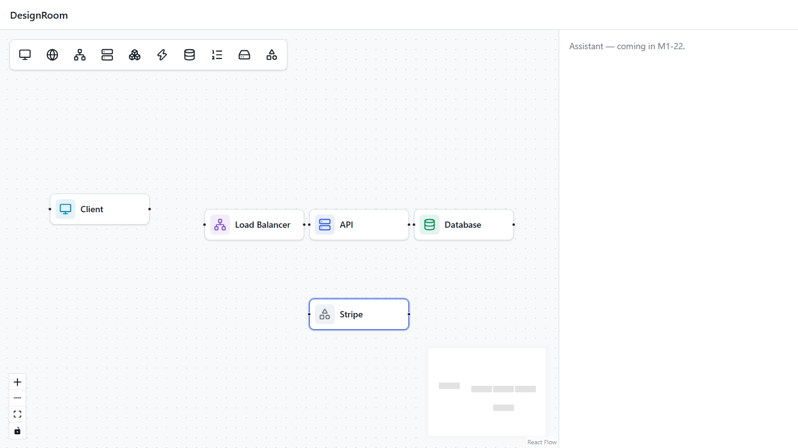
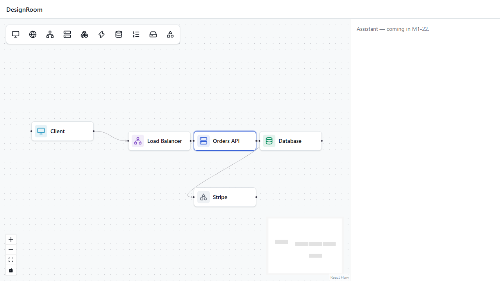
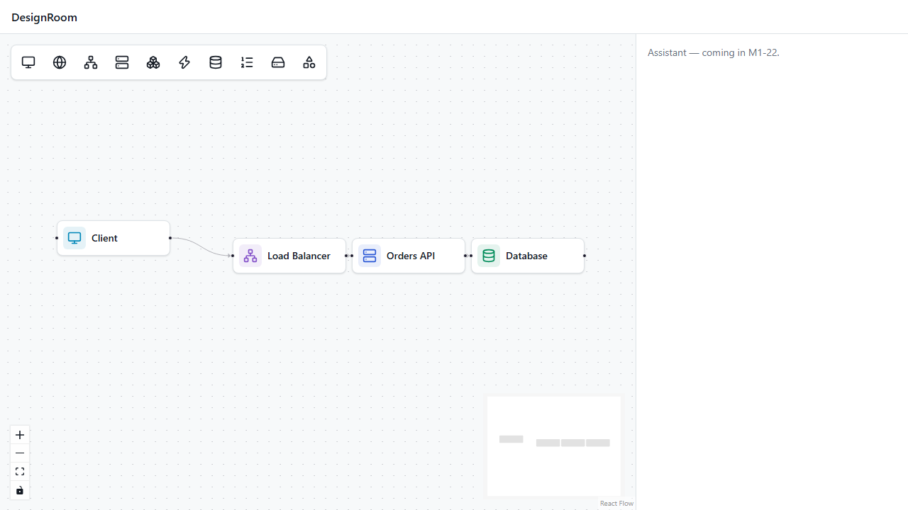

# Checkpoint — M1a (board)

**Date:** 2026-10-18 · **Tickets:** M1-01 … M1-12 · **Decisions:** [ADR-001, 002, 003](../decisions.md)

## Demo — steps 2–5 of the [M1 demo script](../specs/M1-solo-board.md#9-demo-script)

Recorded with Playwright against the production build (screen capture: [demo-steps-2-5.webm](M1a/demo-steps-2-5.webm)).

| Step | Result |
|---|---|
| 2. Add Client, Load Balancer, API, Database, and a Custom node "Stripe" | ✅ Custom opens straight into naming |
| 3. Rename API → "Orders API"; connect Client→LB→API→Database and API→Stripe | ✅ |
| 4. API→API and a duplicate edge are refused | ✅ refused while dragging (`canConnect`) and again in the store |
| 5. Delete Stripe: its edge disappears too | ✅ one store update, no error |

| Nodes | Connected | After deleting Stripe |
|---|---|---|
|  |  |  |

The same flows run on every PR in `apps/web/e2e/board-editing.spec.ts`.

**Seen in the demo:** arrows between nodes that sit close together are barely visible (thin grey line, small arrowhead). Worth a styling pass before the M1 demo video.

## Structure review — did modules/pods help or slow you down?

*Your call — answer in your own words. Facts from building M1a to help:*

- **Helped:**
  - Each pod stayed small: canvas, toolbar and node each have their own tests.
  - Lint caught wrong imports between pods.
  - Moving `kindAppearance` and `flowTypes` up to module level ("promotion on 2nd use") was a one-file move each time.
- **Cost:**
  - Two pods cooperating (toolbar → node: "edit this new Custom node") needed shared state in the module store (`editingNodeId`).
  - React Flow renders node components itself, so they needed a context (`BoardStoreContext`) to reach the store.
  - Deep relative imports (`../../../../../core/ui`).
- **Candidates to simplify before M1b:**
  - A path alias for `core` (`@/core/ui`) to replace the deep relative imports?
  - Anything else you felt was in the way?

**Your verdict:** _…_
