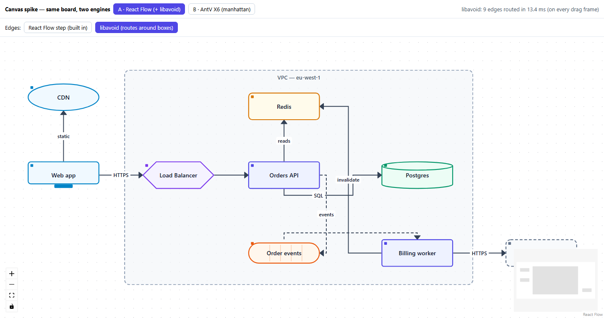
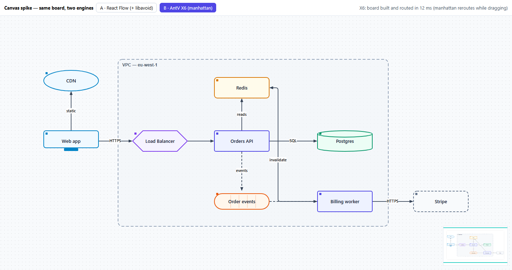
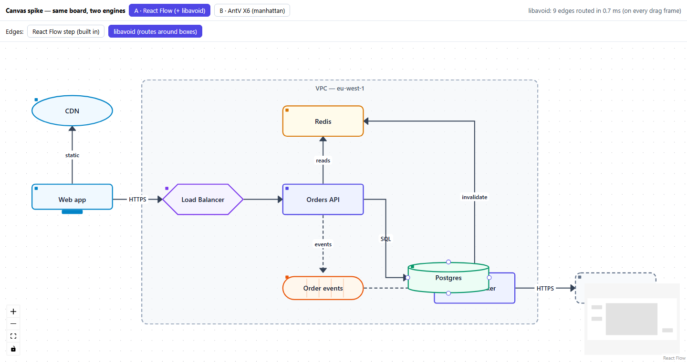
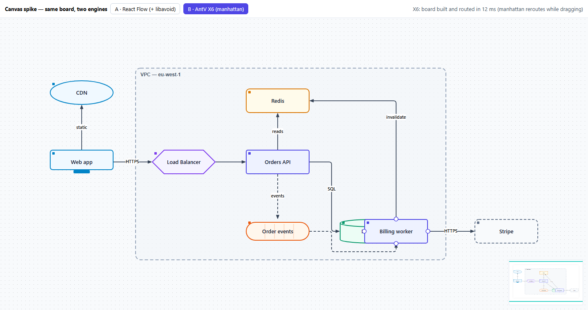

# Spike — canvas engines (2026-10-18)

**Question:** the M1a board reads like a flowchart, not an architecture diagram (draw.io / AWS style). Do we keep React Flow, or move to a diagram engine?

**Setup:** the same board drawn twice, as a standalone Vite app outside the workspace (`pnpm install --ignore-workspace && pnpm dev`, port 5180, or the `spike-canvas` launch entry). The board has a VPC zone, 9 nodes (Web app, CDN, Load Balancer, Orders API, Redis, Postgres, Order events, Billing worker, Stripe) and 9 labelled edges, two of them async (dashed). One edge (`worker → Redis "invalidate"`) has to go around other boxes.

- **A — React Flow 12** with SVG shapes per kind, 4 handles per node, a group node, and two edge modes: built-in `smoothstep`, and **libavoid-js** routing in a custom edge.
- **B — AntV X6 3.1** with the same SVG shapes (via `@antv/x6-react-shape`), ports on 4 sides, an embedded group, and the built-in **manhattan** router.

## Results

| | A · React Flow + libavoid | B · AntV X6 |
|---|---|---|
| Look |  |  |
| After dragging Postgres |  |  |

React Flow's built-in `smoothstep` (no avoidance) is in [results/A-smoothstep.png](results/A-smoothstep.png). Its arrows go straight through boxes. Video of both: [results/demo.webm](results/demo.webm).

| Criterion | A · React Flow + libavoid | B · AntV X6 |
|---|---|---|
| **Architecture look** (shapes, zone, labels, dashed async) | ✅ the same — the look comes from **our SVG shapes**, not the engine | ✅ the same |
| **Routing quality, out of the box** | Good. Routes go around boxes and parallel edges are nudged apart. Some odd first choices (SQL leaving from the bottom of Orders API) need tuning: pins, penalties. | **Cleanest by default.** Two edges can share a segment (`events → worker` on top of `invalidate`). |
| **Routing speed** | 9 edges in **~0.7 ms** per recompute (fresh router each drag frame) | Board built and routed in ~12 ms; reroutes live while dragging |
| **Code for this board** | 304 lines (of which ~90 for libavoid glue) | **129 lines** |
| **Fits our app** | ✅ keeps M1-09…M1-12: store-driven canvas, `toFlow`, label editing, a11y names, unit + e2e tests | ❌ imperative API (`graph.addNode`). The store ↔ graph sync must be hand-written, current canvas/node pods and their tests rewritten, and keyboard/screen-reader support is weaker (SVG `foreignObject` nodes). |
| **Weight** | libavoid wasm ≈ 490 KB (loaded only when needed) | X6 ≈ 570 KB dist (not tree-shaken here) |
| **License** | React Flow MIT, libavoid-js **LGPL-2.1+** (fine as an unmodified, separately loaded wasm; keep its notice) | MIT |
| **Gotchas met** | libavoid-js typings are out of date (constants live under `RouterFlag` / `RoutingParameter` enums). The package doesn't export its `.wasm`, so it's imported by path. | X6 imports `tslib` without declaring it, so pnpm needs `public-hoist-pattern[]=tslib`. Docs are partly Chinese-only. |

## Findings

1. **The "flowchart look" was never React Flow's fault.** It came from our choices: one box style, handles on the left and right only, bezier edges, no labels, no zones. With per-kind SVG shapes, 4-side handles, labels, dashed async and a group node, React Flow looks like draw.io. The same SVG component renders in both engines.
2. **What React Flow lacks is routing around boxes.** libavoid-js fills that gap: it's fast (sub-ms), and its quality is close to X6's manhattan router after tuning.
3. **X6 is the better *drawing tool* out of the box** (less code, cleaner default routes). But it would make us rebuild the canvas around an imperative API and lose the store-driven design, the accessibility work and the tests from M1-09 to M1-12.

## Recommendation (for ADR-004)

Keep React Flow. Add an **"architecture look"** ticket:
- per-kind SVG shapes
- handles on 4 sides (loose connection mode)
- edge labels, plus `mode: sync | async` in the domain
- libavoid routing (behind an `edgeRouting` setting, falling back to `smoothstep`)
- groups/zones later (after M2), as already planned

Revisit X6 or our own renderer only if routing quality or scale (A5/G3) becomes a real problem.

---

## D-0 — can we ship X6? (2026-10-18)

After the decision to move to X6 behind our own package, two risks were checked before any migration work.

### 1. Can our e2e style drive X6? **Yes.**

`e2e/x6.spec.ts` uses the same style as `apps/web/e2e`: role locators, web-first assertions, no sleeps.

- 5 tests: accessible names on all 18 cells; drag a node and its edge reroutes; connect by dragging from a port; duplicate arrow refused; Delete removes a node with its edges.
- **25/25 passed** with `--repeat-each 5` (2 workers). No flakes.
- X6 renders plain SVG with stable `data-cell-id`s, and lets us set our own attributes. The package can give nodes and arrows `role="group"` + `aria-label`, so `getByRole('group', { name: 'Postgres' })` works just as it does with React Flow today.
- Ports get `data-testid="port-right"` etc. Like React Flow handles, they aren't keyboard-operable, so they get no role.
- Delete/Backspace need X6's `Selection` + `Keyboard` plugins. X6 removes a node's edges with it.

Run it (spike folder): `pnpm exec playwright test`.

### 2. Bundle size

Built each engine as its own page (`measure/`, `vite build -c measure/vite.config.ts`). Sizes are gzip; React itself (~70 KB) is shared and left out.

| | JS | Extra |
|---|---|---|
| React Flow + libavoid glue | 76 KB | libavoid wasm 184 KB, loaded only when routing is on |
| **X6 + x6-react-shape** | **167 KB** | routing included |

X6 costs about 90 KB more than React Flow alone, and about 90 KB *less* than React Flow + libavoid. That's acceptable for a desktop-first editor; the diagram package can later be lazy-loaded behind the app shell if needed.

### Verdict

**Go.** Neither risk blocks the move to X6 behind `@designroom/diagram`.
